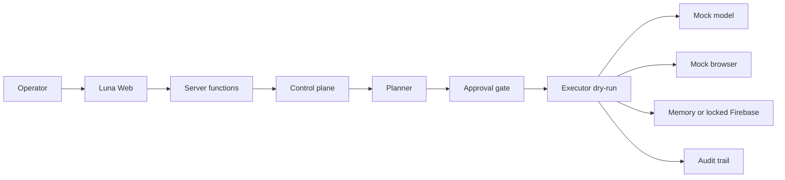

# Kiến trúc Luna — Phase 0/1

## Quyết định stack

Web và backend nằm chung một app TanStack Start. Server functions là ranh giới backend. Lõi trong `src/luna` là TypeScript thuần, không gọi mạng, để test bằng `node:test` và để tách sang process khác ở phase sau nếu cần.

Lý do không dựng Express riêng ở phase này: một tiến trình, một hợp đồng triển khai, và lõi đã không phụ thuộc framework. Auth và database sản phẩm tắt. Trạng thái control plane là bộ nhớ tiến trình, không phải dữ liệu người dùng.

## Ranh giới module

```text
Luna Web (src/routes, src/components/luna)
  └─ server functions (src/luna/server/functions.ts)
       └─ LunaControlPlane
            ├─ agent.ts        planner | executor | lifecycle
            ├─ governance.ts   approval gate
            ├─ models.ts       ModelProvider + 9Router-shaped router
            ├─ browser.ts      capability model, policy, adapters
            ├─ firebase.ts     RealtimeDatabase port + adapters
            └─ config.ts       public config only, never secret values
```

| Module       | Trạng thái Phase 0/1 | Được phép                          | Bị cấm                              |
| ------------ | -------------------- | ---------------------------------- | ----------------------------------- |
| Web          | chạy                 | tạo tác vụ, duyệt, xem audit       | gửi mode live                       |
| Agent        | chạy                 | phân rã mục tiêu, dry-run          | thực thi live                       |
| Model Router | mock                 | alias, combo, tên `provider/model` | `fetch` tới 9Router                 |
| Browser      | mock + stub          | capability model, policy           | Playwright/Skyvern/Browser Use thật |
| Firebase     | memory hoặc locked   | đọc/ghi bộ nhớ khi không xin live  | SDK, credential, mạng               |
| Governance   | chạy                 | approval, dry-run, audit           | tắt phase lock từ UI                |

## Luồng dữ liệu



1. Operator tạo `AgentTask` ở trạng thái `draft`. API bỏ qua và từ chối `mode: live`.
2. Planner cục bộ sinh `Plan`. Bước `sensitive` đặt task thành `awaiting_approval` và mở `ApprovalRequest`.
3. `decideExecution` từ chối live trước cả khi xét duyệt. Dry-run nhạy cảm cần `approved`.
4. Executor chỉ chạy khi cổng mở. `external_mutate` và ghi Firebase trả `refused` mà không gọi adapter ghi. Browser nhạy cảm không được thực thi.
5. Mọi `AuditEvent` có `dryRun: true`.

## Hợp đồng 9Router

Router tương thích cách đặt tên của 9Router:

- Base mặc định `http://127.0.0.1:20128/v1`.
- Model dạng `provider/model`, alias (`luna-fast`) và combo (`luna-resilient`).
- `NineRouterProvider.complete` ném `PhaseLockedError` trước khi gọi `fetch`.
- `LUNA_ALLOW_LIVE_MODELS=true` chỉ được ghi nhận. `liveEnabled` vẫn là `false`.

## Firebase

`RealtimeDatabase` có `get`, `set`, `push`, `update`, `remove`, `listen`.

- `MemoryRealtimeDatabase` dùng cho demo và test.
- `PhaseLockedFirebaseAdapter` là adapter live. Mọi method thất bại mà không mở socket.
- `LUNA_FIREBASE_LIVE=true` chọn adapter khóa, không fallback im lặng sang bộ nhớ.
- Config công khai chỉ chứa host, project id và cờ `credentialConfigured`. Giá trị secret không được copy vào object trả về.

## Browser

Capability: `navigate`, `snapshot`, `click`, `type`, `extract`, `login`, `upload`, `download`.

Ba capability cuối là nhạy cảm và bị `refused`. Policy Phase 0/1 luôn chọn adapter `mock`. Stub `playwright`, `skyvern`, `browser-use` ném lỗi nếu bị gọi trực tiếp. Orchestrator không gọi chúng.

## Cấu hình

Xem [.env.example](.env.example). Tên biến:

- `FIREBASE_PROJECT_ID`
- `FIREBASE_DATABASE_URL`
- `FIREBASE_SERVICE_ACCOUNT_JSON`
- `LUNA_FIREBASE_LIVE`
- `NINE_ROUTER_BASE_URL`
- `NINE_ROUTER_API_KEY`
- `LUNA_ALLOW_LIVE_MODELS`

URL có userinfo hoặc query bị từ chối để secret không nằm trong chuỗi kết nối.

## Lộ trình

| Phase | Việc                                       | Cần chủ repo                                   |
| ----- | ------------------------------------------ | ---------------------------------------------- |
| 0/1   | Bootstrap, port, mock, test                | Không, đang làm                                |
| 2     | Firebase RTDB thật sau cổng duyệt          | Chọn project và người giữ credential           |
| 3     | 9Router live                               | Quyết định chi phí và provider                 |
| 4     | Adapter browser thật, vẫn dry-run mặc định | Chính sách duyệt thao tác trình duyệt          |
| 5     | Zalo / eOffice                             | Quyết định sản phẩm riêng. Không tự triển khai |

Phase 5 không bắt đầu chỉ vì các port đã có. Không có hành động production nào trong các phase trước nếu chủ repo chưa chấp nhận.

## Quyết định kỹ thuật đã chốt

- Không thêm Firebase SDK khi chưa có project.
- Không thêm HTTP client cho model. Mock là adapter mặc định.
- Không bật auth. Control plane là một operator cục bộ.
- Phase lock là hằng hành vi, không phải nút trên UI.
- Tiếng Việt trên bàn điều khiển vì vận hành được mô tả bằng tiếng Việt.
