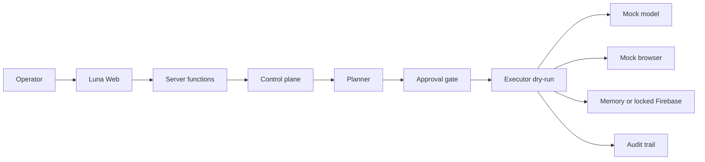

# Kiến trúc Luna — Phase 0/1

## Quyết định stack

Web và backend nằm chung một app TanStack Start. Server functions là ranh giới backend. Lõi trong `src/luna` là TypeScript thuần, không gọi mạng, để test bằng `node:test` và để tách sang process khác ở phase sau nếu cần.

Lý do không dựng Express riêng ở phase này: một tiến trình, một hợp đồng triển khai, và lõi đã không phụ thuộc framework. Auth và database sản phẩm tắt. Trạng thái control plane là bộ nhớ tiến trình, không phải dữ liệu người dùng.

## Ranh giới module

```text
Luna Web (src/routes, src/components/luna)
  └─ server functions (src/luna/server/functions.ts)
       └─ LunaControlPlane
            ├─ agent.ts        planner | executor | lifecycle
            ├─ governance.ts   approval gate
            ├─ models.ts       ModelProvider + 9Router-shaped router
            ├─ browser.ts      capability model, policy, adapters
            ├─ firebase.ts     RealtimeDatabase port + adapters
            └─ config.ts       public config only, never secret values
```

| Module       | Trạng thái Phase 0/1 | Được phép                          | Bị cấm                              |
| ------------ | -------------------- | ---------------------------------- | ----------------------------------- |
| Web          | chạy                 | tạo tác vụ, duyệt, xem audit       | gửi mode live                       |
| Agent        | chạy                 | phân rã mục tiêu, dry-run          | thực thi live                       |
| Model Router | mock                 | alias, combo, tên `provider/model` | `fetch` tới 9Router                 |
| Browser      | mock + stub          | capability model, policy           | Playwright/Skyvern/Browser Use thật |
| Firebase     | memory hoặc locked   | đọc/ghi bộ nhớ khi không xin live  | SDK, credential, mạng               |
| Governance   | chạy                 | approval, dry-run, audit           | tắt phase lock từ UI                |

## Luồng dữ liệu



1. Operator tạo `AgentTask` ở trạng thái `draft`. API bỏ qua và từ chối `mode: live`.
2. Planner cục bộ sinh `Plan`. Bước `sensitive` đặt task thành `awaiting_approval` và mở `ApprovalRequest`.
3. `decideExecution` từ chối live trước cả khi xét duyệt. Dry-run nhạy cảm cần `approved`.
4. Executor chỉ chạy khi cổng mở. `external_mutate` và ghi Firebase trả `refused` mà không gọi adapter ghi. Browser nhạy cảm không được thực thi.
5. Mọi `AuditEvent` có `dryRun: true`.

## Hợp đồng 9Router

Router tương thích cách đặt tên của 9Router:

- Base mặc định `http://127.0.0.1:20128/v1`.
- Model dạng `provider/model`, alias (`luna-fast`) và combo (`luna-resilient`).
- `NineRouterProvider.complete` ném `PhaseLockedError` trước khi gọi `fetch`.
- `LUNA_ALLOW_LIVE_MODELS=true` chỉ được ghi nhận. `liveEnabled` vẫn là `false`.

## Firebase

`RealtimeDatabase` có `get`, `set`, `push`, `update`, `remove`, `listen`.

- `MemoryRealtimeDatabase` là mặc định cho local và test, kể cả khi URL project đã được khai báo.
- `PhaseLockedFirebaseAdapter` được chọn khi `FIREBASE_LIVE_ENABLED=true` hoặc alias `LUNA_FIREBASE_LIVE=true` nhưng thiếu URL https chính thức, REST credential, hoặc transport. Không mở socket.
- Project công khai đã ghi nhận: `lunazl-agent`, URL `https://lunazl-agent-default-rtdb.asia-southeast1.firebasedatabase.app`. Đây không phải secret.
- Rules mẫu deny `.read` và `.write`. Không deploy và không mở public access.
- Config công khai chỉ chứa host, project id và cờ `credentialConfigured`. Giá trị secret không được copy vào object trả về.

## Browser

Capability: `navigate`, `snapshot`, `click`, `type`, `extract`, `login`, `upload`, `download`.

Ba capability cuối là nhạy cảm và bị `refused`. Policy Phase 0/1 luôn chọn adapter `mock`. Stub `playwright`, `skyvern`, `browser-use` ném lỗi nếu bị gọi trực tiếp. Orchestrator không gọi chúng.

## Cấu hình

Xem [.env.example](.env.example). Tên biến:

- `FIREBASE_PROJECT_ID`
- `FIREBASE_DATABASE_URL`
- `FIREBASE_SERVICE_ACCOUNT_JSON`
- `FIREBASE_LIVE_ENABLED`
- `LUNA_FIREBASE_LIVE`
- `NINE_ROUTER_BASE_URL`
- `NINE_ROUTER_API_KEY`
- `LUNA_ALLOW_LIVE_MODELS`

URL có userinfo hoặc query bị từ chối để secret không nằm trong chuỗi kết nối.

## Lộ trình

| Phase | Việc                                       | Cần chủ repo                                   |
| ----- | ------------------------------------------ | ---------------------------------------------- |
| 0/1   | Bootstrap, port, mock, test                | Không, đang làm                                |
| 2     | Schema v1 và URL project lunazl-agent, live vẫn khóa | Người giữ REST credential trước khi cho phép connect |
| 3     | 9Router live                               | Quyết định chi phí và provider                 |
| 4     | Adapter browser thật, vẫn dry-run mặc định | Chính sách duyệt thao tác trình duyệt          |
| 5     | Deployment dry-run local/staging           | Không publish. Staging có mạng cần chủ repo    |
| 6     | Security hardening local                   | Không mở mạng, không đổi rules trên console    |
| 7     | Production readiness, mặc định NO-GO       | Staging, credential, ngân sách, policy         |
| 8     | Staging readiness, mặc định NO-GO          | URL, chủ môi trường, credential, ngân sách    |
| 9     | Production go/no-go, mặc định NO-GO        | Sign-off, ngân sách, pháp lý, policy           |
| 10    | Validation mô phỏng, không phải production | Không báo đã deploy                        |
| 11    | Governance local, không nhận cờ giả        | Owner tách biệt, ngân sách, pháp lý            |
| 12    | Operational readiness local, mặc định NO-GO | Evidence, owner, budget, health, alerting    |
| 13    | Zalo / eOffice                             | Quyết định sản phẩm riêng. Không tự triển khai |

Phase 12 không gọi mạng và không biến evidence local thành quyền deploy. Zalo và eOffice vẫn chưa bắt đầu. Phase 11 không biến một cờ môi trường thành sign-off.

## Quyết định kỹ thuật đã chốt

- Không thêm Firebase SDK khi chưa có project.
- Không thêm HTTP client cho model. Mock là adapter mặc định.
- Không bật auth. Control plane là một operator cục bộ.
- Phase lock là hằng hành vi, không phải nút trên UI.
- Tiếng Việt trên bàn điều khiển vì vận hành được mô tả bằng tiếng Việt.

## Phase 2 foundations

Persistence đi qua `LunaStore`. Control plane không ghi Firebase SDK và không mở socket. `MemoryLunaStore` là mặc định. `FirebaseLunaStore` chỉ nói chuyện với port `RealtimeDatabase`.

Model Router đăng ký provider `mock` và `nine-router`. Mọi `complete` của router chọn mock. Policy timeout/retry nằm trên config công khai. `retriesExecuted` luôn là 0 ở phase này. Usage có `estimatedCostUsd: 0` và `billed: false`. API key không được copy vào object config.

Chi tiết path và quy tắc migration: [docs/SCHEMA.md](docs/SCHEMA.md).

## Phase 3 controlled integration

`runControlledFlow` đi từ tạo tác vụ, planner, cổng duyệt, dry-run, audit rồi tới trạng thái kết thúc. Tác vụ nhạy cảm không có quyết định thì dừng ở `awaiting_approval`.

Firebase emulator ở Phase 3 là `InProcessRtdbTransport`: chỉ nhận `http` trên loopback và từ chối URL production. `LUNA_FIREBASE_EMULATOR=true` chỉ được ghi nhận. Factory của server vẫn trả memory adapter và không mở socket. Rules mẫu không được deploy.

Model Router có thể giả lập timeout hoặc unavailable. Số lần thử là `maxRetries + 1`, toàn bộ trong tiến trình, `estimatedCostUsd` vẫn là 0, `fetch` không được gọi. 9Router live vẫn ném `PhaseLockedError`.

Browser Orchestrator công bố contract cho `mock`, `playwright`, `skyvern` và `browser-use`. Mọi contract có `liveLaunch: false`. Stub không được gọi.

## Phase 4 controlled adapters

Contract nằm ở `src/luna/adapters.ts`. Firebase mặc định là memory và offline. 9Router mặc định là mock, `evaluateNineRouterConnect` không gọi `fetch` dù live được yêu cầu hoặc key được cấu hình. Playwright, Skyvern và Browser Use có `liveLaunch: false`.

Emulator Firebase vẫn là `InProcessRtdbTransport` và từ chối URL production. Vận hành: [docs/OPERATIONS.md](docs/OPERATIONS.md).

## Phase 5 controlled deployment

Ba môi trường được tách bằng `LUNA_DEPLOY_TARGET`: `local`, `staging`, `production`. Mặc định là local. Production luôn thất bại preflight, kể cả khi `LUNA_DEPLOY_PRODUCTION_OPT_IN=true`. Staging chỉ được dry-run nếu URL trống hoặc là loopback. URL public làm preflight thất bại và không được fetch.

`npm run deploy:dry-run` quét file công khai, biến môi trường và artifact local. Nó không đọc `.env`, không deploy Firebase rules, không publish và không mở socket. Health check từ chối mọi URL không phải `http` trên `127.0.0.1` hoặc `localhost`. Rollback là `local-no-op`: không đổi process đang chạy và không gọi hosting.

Workflow [`.github/workflows/deploy-dry-run.yml`](.github/workflows/deploy-dry-run.yml) chỉ chạy preflight với quyền `contents: read`.

## Phase 6 security hardening

`src/luna/security.ts` quét secret mà không trả giá trị, buộc Firebase rules deny-all, redact audit và lỗi, và giữ live gate ở `false`. Rate-limit là bộ đếm trong tiến trình. Header an toàn không khoá iframe của preview.

Mô hình đe doạ, ranh giới tin cậy và rollback sự cố: [docs/SECURITY.md](docs/SECURITY.md).

## GitHub

`main` đã gồm [pull/3](https://github.com/Anhtran88/Luna.zl-Agent/pull/3). Phase 4 đến 11 vẫn là draft. Phase 12 ở `phase-12-operational-readiness`: checklist vận hành local, không chuyển GO. Không đưa token vào source.
